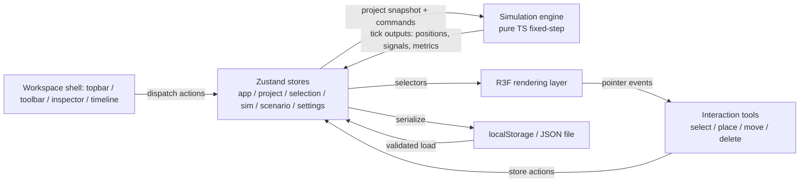

# Design

## Context

The current app (`front-end/src`) is a 500vh scroll-driven landing page over a static R3F scene: `CinematicCamera` (GSAP ScrollTrigger) fights `OrbitControls`; `City.tsx` holds a module-level `trafficState` singleton mutated by a 100ms interval; `TrafficSystem.tsx` self-animates 24 cars in `useFrame` with `Math.random()` generation, a dead `vehiclePositions` registry, and a `useMemo` cleanup that never runs; generation is non-deterministic per mount; ~490 draw calls with point+spot shadow casting and per-frame `ContactShadows`; `<Environment preset="city">` fetches an HDRI from a CDN at runtime. State is props-drilled `useState` duplicated across 4 pages. All external services are off (`site.features.* = false`), so `/cctv`, `/ai-prediction`, `/real-time-traffic` render `NotConfigured` — safe to remove. No specs exist yet; this change introduces the first 11 capabilities (see proposal.md). Constraints: browser-only, no backend/API keys, existing stack (Next.js 16, React 19, R3F 9, Drei 10, Tailwind 4, GSAP, Framer Motion), target hardware i3-7100 / 8 GB / GT 710 (2 GB VRAM).

## Goals / Non-Goals

**Goals:**
- A layered architecture where rendering consumes simulation output and never owns simulation rules.
- Deterministic, headless-testable simulation engine (pure TS, seeded RNG, fixed timestep).
- One workspace shell with four modes; every visible control has real behavior.
- Migration that keeps the app shippable at each phase boundary (old landing removed only when workspace shell lands).

**Non-Goals:**
- Real plugin loading, runtime code splitting per module, or third-party plugin support.
- IndexedDB (localStorage suffices until measured otherwise).
- Any backend, AI, live-data, or auth-server integration — ports only.
- Graphical fidelity beyond what GT 710 renders at interactive rates.
- Preserving the AI-surveillance UI or the three side routes.

## Decisions

### D1. Layered architecture with one-way data flow
Four layers: **state** (Zustand stores) → **simulation engine** (pure TS, advances on its own clock) → **rendering** (R3F components read state, never mutate engine rules) → **UI** (shell panels dispatch actions). Interaction tools dispatch store actions; stores call engine commands.
- *Why*: the current design mixes all three (render-coupled `trafficState`, `setState` inside `useFrame`); one-way flow is what makes determinism, undo, and headless testing possible.
- *Alternative*: keep module singletons + context — rejected: reproduces today's bugs and makes undo/redo unnatural.

### D2. Zustand (new dependency) with six slices/stores
`useAppStore` (mode, project name, dirty/saved state), `useProjectStore` (city objects by id, seed, undo/redo history), `useSelectionStore` (selected id, hover id), `useSimStore` (status, simTime, speed, live metric snapshot), `useScenarioStore` (scenarios, active scenario, events, results), `useSettingsStore` (quality tier, layer visibility, persisted).
- *Why*: Zustand (~1 kB) gives non-prop-drilling, selector-based subscriptions (critical: R3F components re-render only on their slice), and trivial undo/redo via snapshot arrays on the project store. React Context would re-render whole trees per edit — unacceptable with 3D content.
- *Why stores not slices-in-one*: the sim tick writes every frame; isolating it prevents tick updates from re-rendering toolbar/inspector.
- *Undo/redo*: command-pattern is overkill for v1 — keep bounded (≤50) before/after JSON snapshots of the project store only (project data is small; simulation state excluded).

### D3. Simulation engine: pure TS class with injectable clock
`SimulationEngine` lives in `src/lib/simulation/`, imports nothing from React/Three/DOM. API: `constructor(project, seed)`, `step(dtFixed)`, `play()/pause()/reset()`, `onTick(cb)`, `getSnapshot()`. The React side runs it from a single rAF driver that accumulates wall-clock delta and calls `step(1/20s)` N times, then publishes a throttled snapshot (positions as Float32Array per layer, signal states, metrics) to `useSimStore` and directly to instanced-mesh refs.
- *Why*: fixed timestep + seeded RNG (`mulberry32`, seed stored in project) satisfies determinism (acceptance 7); rAF-accumulator keeps sims consistent across 30/60 Hz displays.
- *Vehicle→render*: vehicles are read by an `InstancedMesh` updater writing matrices in `useFrame` from the last snapshot — zero React re-renders per vehicle per frame (directly addresses "avoid React state per vehicle per frame").
- *Alternative*: Web Worker — rejected for v1: adds serialization overhead/complexity; revisit only if step time measurably exceeds budget (see Risks).

### D4. City model: normalized plain objects keyed by id
`CityProject = { version, seed, objects: Record<ObjectId, CityObject>, order: ObjectId[], scenarios, settings }`. `CityObject` is a discriminated union on `type`: `road | building | vehicle | signal | incident | zone`, each with typed props (road geometry defines derived length). Road graph is a derived index (`adjacency` computed from roads) rebuilt on project mutation, not stored twice.
- *Why*: normalized record gives O(1) selection updates, stable ids across save/load (spec), and simple JSON round-trip. Discriminated union gives the inspector exhaustive typing instead of today's `any` props.

### D5. Placement validation as pure functions
`canPlace(objects, candidate, bounds)` returns `{ ok } | { ok: false, reason }` used by both the ghost preview (invalid styling) and the actual placement action — one source of truth.
- *Why*: prevents preview/action divergence; gives the inspector and toast the same human-readable reason.

### D6. Rendering refactor: instancing + offline assets + bounded lights
- Replace `<Environment preset="city">` with a `THREE.PMREMGenerator`-baked procedural environment or drei `<Environment>` with a locally bundled tiny HDR — removes the CDN fetch (spec: offline rendering).
- One shadow-casting directional light; `ContactShadows` gets `frames={1}`-style caching or removal; drop point-light shadows; remove the 4 CCTV point lights with the CCTV removal.
- Instanced: vehicles (single InstancedMesh per body-type), signal poles/lights (replace 180 meshes), buildings (InstancedMesh with per-instance height/scale — currently 49 individual meshes), plus keep existing instanced windows/dashes/streetlights.
- `CinematicCamera` deleted; `OrbitControls` enabled with pan/zoom and min/max distance (spec).
- *Why*: draw-call budget on GT 710; the audit shows ~490 draws with 6-pass cube shadows — the single largest perf lever.

### D7. Modes = capability filter, not routing
Mode is a value in `useAppStore`; toolbar/panels derive availability via selectors (`toolsForMode(mode, enabledModules)`). No route changes; the workspace is the single page.
- *Why*: mode switching without reload (spec); keeps tool gating consistent with module gating (D8).

### D8. Module registry: compile-time array, runtime toggle
`src/lib/modules/registry.ts` exports `modules: SandboxModule[]` (mobility enabled by default). The workspace derives toolbar tools, placeable types, layers, and metrics from enabled modules. No dynamic import, no sandboxing (spec).
- *Why*: the spec forbids plugin frameworks; a typed array satisfies "declare capabilities" with ~0 machinery. Future domains add a new array entry + its object-type handlers.

### D9. Persistence: localStorage with versioned envelope
`cityfluxy.project.<id>` keys holding a versioned envelope `{version, savedAt, project}`; `serializeProject()/parseProject(json)` with structural validation (required fields, enum checks, value ranges) returning typed errors for import UX. Settings under a separate `cityfluxy.settings` key. Export = pretty JSON download; import = file input → validate → replace.
- *Why*: spec requires localStorage-first, no backend, and specific import errors; versioned envelope gives an upgrade path without IndexedDB.

### D10. Disconnected ports
`src/lib/ports/BackendPort.ts`, `AIProviderPort.ts`, `DataProviderPort.ts` — interfaces only, with optional-injection seams: features call `port ?? localAdapter` (local adapters being D9's functions).
- *Why*: satisfies "consumable through dependency injection" while guaranteeing zero network code paths.

### D11. Visual direction
Keep existing tokens (`--background #020617`, `--accent #0ea5e9`, `--neon-cyan`, `.glass`) — they already match the "dark slate/navy + restrained cyan/violet" brief. Fix the font mismatch (load Geist properly, drop hardcoded unloaded Inter). GSAP retained only where justified (undo/panel transitions are Framer Motion; GSAP becomes optional — remove if nothing uses it after CinematicCamera dies).

## Risks / Trade-offs

- [GSAP scroll camera removal changes the "wow" first impression] → Accept: product direction is a tool, not a landing page; Explore mode gets a short non-scroll camera intro instead (optional, cut first under time pressure).
- [Simulation step time could exceed frame budget at max entity counts] → Mitigate: entity budgets per tier (spec), measure step time in the perf strategy; fallback: move engine to a Web Worker (API already serializable via snapshots).
- [Snapshot-based undo has memory cost] → Mitigate: bound to 50 steps, project store only (objects are small plain data); monitor.
- [Instancing vehicles complicates per-vehicle hover/selection] → Mitigate: R3F `<Instance>`/instance-id picking for hover; fall back to a small non-instanced set only for vehicles near the pointer if picking proves flaky.
- [Removing `/cctv` et al. breaks any external links] → Mitigate: routes already render `NotConfigured` and are feature-flagged off; no in-repo links depend on them beyond `href="#"`.
- [Single big-bang change risks long-lived branch] → Mitigate: phase ordering in tasks.md keeps each phase independently reviewable (see Migration Plan).
- [Zustand + project snapshot serialization could serialize engine references] → Mitigate: strict rule — stores hold plain data only; engine instance lives outside stores (module-scoped ref), snapshots are plain arrays/records.

## Migration Plan

**Migration boundaries (verified against proposal.md "Impact"):**

*Reusable (keep, refactor in place):* `Scene.tsx` + `City.tsx` + `TrafficSystem.tsx` R3F core patterns (instanced windows/dashes/streetlights), `Navbar.tsx` shell (strip surveillance chrome), `AuthSection.tsx`/`ProfileModal.tsx`/`NotConfigured.tsx`/`lib/auth.ts` (feature-flagged off), `.glass`/neon design tokens + palette in `globals.css`, `config/site.ts` constants.

*Removed in Phase 1:* `CinematicCamera.tsx`, `AIDetectionView.tsx`, `InvestigationDashboard.tsx`, `CityHUD.tsx` fake stats, `AnimatedTrafficSignal.tsx`, `page.tsx` 500vh landing sections + footer, routes `app/cctv/`, `app/ai-prediction/`, `app/real-time-traffic/`, `public/realtime-traffic.html`, Navbar "Active Surveillance" indicator.

*Replaced by new modules:* module singletons `trafficState`/`vehiclePositions` → Zustand stores + engine; hardcoded road layout/`Math.random` generation → seeded `generateProject`.

1. **Phase 0 audit/type foundation** lands first (core types, seed RNG, `canPlace`) — additive, no behavior change.
2. **Phase 1 workspace shell** replaces `page.tsx` landing sections and ports `Scene/City` behind it — the BREAKING cut happens here, in one reviewable commit series; old UI components are deleted in the same phase so no dead fake-metric code ships.
3. **Phases 2–4** (viewport/selection, engine, scenarios/analytics) are additive behind the shell.
4. **Phase 5** persistence/ports/modules; **Phase 6** polish/perf/docs/demo scenario.
- *Rollback*: no data-format consumers exist outside the app; git revert per phase works because each phase is self-contained; project JSON format is versioned from day one so future changes can migrate.
- *Old vs new*: the AI-surveillance routes and components are removed in Phase 1, not progressively disabled — they are feature-flagged off already, so no user loses active functionality.

## Open Questions

- Exact pass thresholds for the performance test strategy (e.g., ≥30 fps Explore mode default city) — to be set from first measurements on the target machine during Phase 6; the spec requires thresholds to be recorded, not pre-decided here.
- Whether GSAP is kept for any surviving animation — resolved by inspection during Phase 1; if no consumer remains, drop the dependency then.
